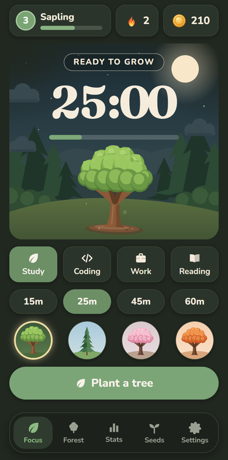
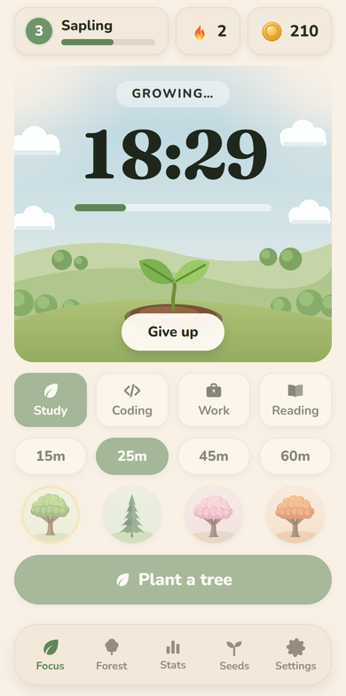
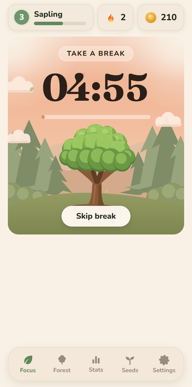
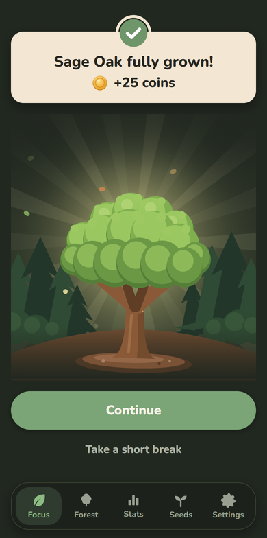
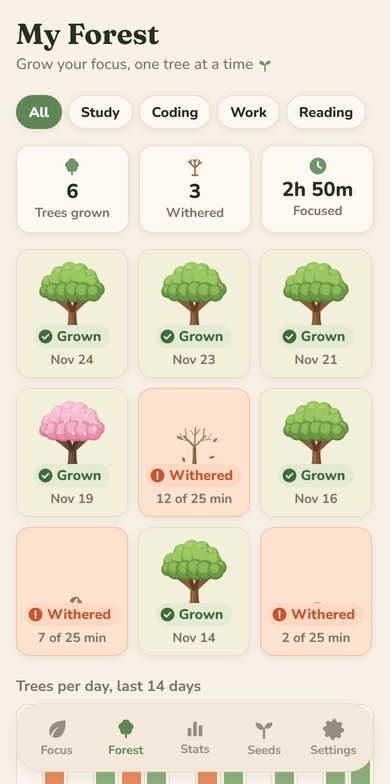
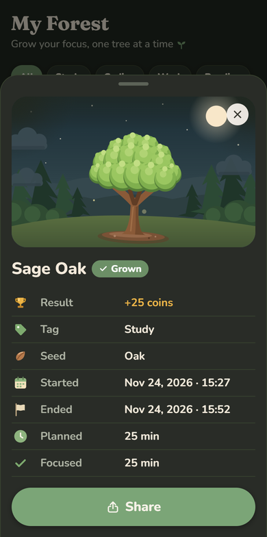
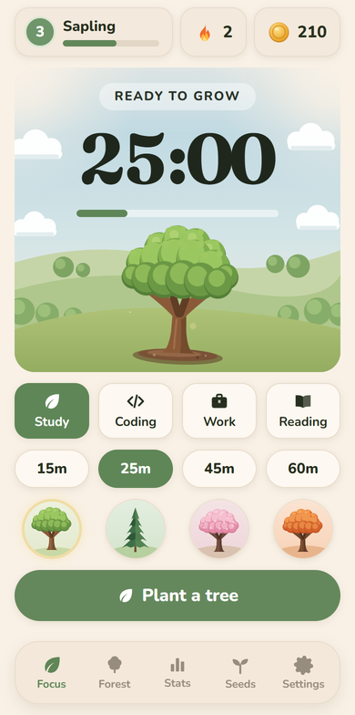
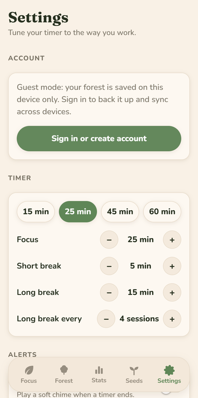

# Forest Pomodoro 🌳

_Focus. Grow. Breathe._ A Forest-style Pomodoro timer for iOS, Android and the web. Start a focus
session and a tree grows from seed to full tree on screen. Stay focused to add it to your forest;
give up or leave the app and it withers.

Built with **Expo SDK 58 / React Native 0.88**, Expo Router, Zustand, react-native-svg and Reanimated,
with optional **Supabase** auth and cloud sync.

| Idle (dark) | Focus (light) | Break | Completed |
| --- | --- | --- | --- |
|  |  |  |  |

| My Forest | Tree detail | Idle (light) | Settings |
| --- | --- | --- | --- |
|  |  |  |  |

## Features

- **Growing tree timer**: seed → sprout → sapling → full tree, drawn as animated vector art (crisp on
  every screen). Trees sway, breathe, react when tapped, and celebrate when you finish.
- **Focus rules**: give up, or leave the app/tab longer than the grace period, and the tree withers.
  The timer runs from a stored end time, so backgrounding or reloading never loses time.
- **Tags & durations**: Study / Coding / Work / Reading, 15 / 25 / 45 / 60 min presets (or custom),
  short and long breaks.
- **My Forest**: grid of every session with clear Grown / Withered badges, filters by tag, totals, a
  14-day trees-per-day chart, and a detail sheet per tree (with sharing).
- **Progress**: levels with XP, daily streak, coins (1 per focused minute) and four unlockable species.
- **Stats**: today / last 7 days, daily focus chart, recent sessions, time by tag.
- **Settings**: timer lengths, sound + haptic alerts, strict mode, a **Growth lab** to preview every
  animation state, and account management.
- **Accounts & sync (optional)**: email/password sign-up, sign-in, sign-out and password reset via
  Supabase (PKCE). Works fully offline as a guest; signing in merges guest sessions, coins and species
  into the account and keeps devices in sync.
- **Light & dark themes** following the design mockups in [`design/mockups`](design/mockups).

## Getting started

Prerequisites: Node 20+, npm, and either a phone with Expo Go / a development build, an emulator, or a browser.

```bash
npm install
cp .env.example .env.local   # optional: only needed for accounts & cloud sync
npm run web                  # or: npm run ios / npm run android / npm start
```

Without `.env.local` the app runs in local-only guest mode.

### Scripts

| Command | What it does |
| --- | --- |
| `npm start` | Expo dev server (scan the QR code with Expo Go or a dev build) |
| `npm run web` / `ios` / `android` | Start on a specific platform |
| `npm test` | Jest unit tests (timer engine, stats, progress, sync merge rules) |
| `npm run typecheck` | `tsc --noEmit` |
| `npm run lint` | ESLint (`expo lint`) |
| `npx expo-doctor` | Dependency / config health check |

## Cloud sync with Supabase (optional)

The app shares an existing Supabase project, so every table is prefixed `pomodoro_`:

- `pomodoro_profiles`: coins, selected / unlocked species, focus streak, settings (one row per user)
- `pomodoro_sessions`: one row per finished focus session

Both have Row Level Security with `auth.uid() = user_id` policies for select, insert (`WITH CHECK`),
update (`USING` + `WITH CHECK`) and delete; the `anon` role has no access. CHECK constraints validate
every column server-side, and the `pomodoro_guard_coins` trigger rejects any profile whose coins plus
unlocked-species cost exceed the coins its sessions actually earned. Schema:
[`supabase/migrations`](supabase/migrations) (`*_pomodoro_schema.sql`, `*_pomodoro_guard_coins.sql`).

1. Fill in `.env.local` (see [`.env.example`](.env.example)):
   ```bash
   EXPO_PUBLIC_SUPABASE_URL=https://<project-ref>.supabase.co
   EXPO_PUBLIC_SUPABASE_ANON_KEY=<anon key>
   ```
   Only the **anon** key belongs in the app. Never put the `service_role` key in an `EXPO_PUBLIC_` variable.
2. Apply the migration:
   ```bash
   npx supabase login
   npx supabase link --project-ref <project-ref>
   npx supabase db push --remote
   ```
   The `*_habit_tracker_app_placeholder.sql` files are intentionally empty: they mirror migrations
   that the other app already applied to the shared project, so `db push` only applies `pomodoro_*`.
3. In the Supabase dashboard → **Authentication → URL Configuration**, add the app's redirect URLs
   (for example `pomodoroapp://**` and your web origin) so confirmation and reset links open the app.

Session tokens are stored in the iOS Keychain / Android Keystore via `expo-secure-store`
(chunked, since sessions can exceed 2 KB) and in `localStorage` on web.

## Distribution for $0 (no store fees)

### Android: installable `.apk` via EAS (free tier)

```bash
npx eas-cli@latest login
npx eas-cli@latest init                      # first time only: creates the EAS project (commit the projectId it adds)
# Cloud builds can't see .env.local, so store the public Supabase values on EAS once:
npx eas-cli@latest env:set --name EXPO_PUBLIC_SUPABASE_URL --value https://<project-ref>.supabase.co --environment preview --visibility plaintext
npx eas-cli@latest env:set --name EXPO_PUBLIC_SUPABASE_ANON_KEY --value <anon key> --environment preview --visibility plaintext
npx eas-cli@latest build -p android --profile preview
```

The `preview` profile in [`eas.json`](eas.json) builds an `.apk` (`android.buildType: "apk"`). Open the
build link on your phone, download and install it (allow installs from your browser when asked).
Free-tier builds wait in a shared queue and have a monthly limit.

### Web / PWA on Vercel (free)

```bash
npm run build:web      # expo export -p web + copies app-store/{privacy,terms,support}.html into dist/
npm run serve:web      # preview the production build locally
```

1. Import the GitHub repo at [vercel.com/new](https://vercel.com/new). [`vercel.json`](vercel.json)
   already sets the build command, the `dist` output and security / caching headers.
2. In Vercel → Project → Settings → Environment Variables, add `EXPO_PUBLIC_SUPABASE_URL` and
   `EXPO_PUBLIC_SUPABASE_ANON_KEY`, then deploy.
3. Add the Vercel domain to Supabase → Authentication → URL Configuration.
4. Install it on a phone: **iPhone** Safari → Share → *Add to Home Screen*; **Android** Chrome → ⋮ →
   *Install app*. It runs full-screen and works offline (service worker in [`public/sw.js`](public/sw.js),
   manifest in [`public/manifest.json`](public/manifest.json), wired up in [`src/app/+html.tsx`](src/app/+html.tsx)).

The site also serves the legal pages at `/privacy`, `/terms` and `/support`.

### Icons and store metadata

- App, adaptive, splash and PWA icons are rendered from the SVG sources in [`assets/brand`](assets/brand)
  (the app's own oak art). The 1024 × 1024 `assets/images/icon.png` is opaque, with no alpha channel, as
  the App Store requires.
- [`app-store/`](app-store) holds the store listing text, privacy answers and a pre-publication checklist
  ([`listing.md`](app-store/listing.md)) plus [`privacy.html`](app-store/privacy.html),
  [`terms.html`](app-store/terms.html) and [`support.html`](app-store/support.html), ready for a future
  App Store / Google Play submission.

## Architecture

```
src/
  app/                 Expo Router screens: index (Focus), forest, stats, seeds, settings, _layout
  components/          UI kit (ui.tsx), growth stage, scene + tree SVG art, sheets, icons, tab bars
    tree/              tree-svg (all species × growth stages), species-badge
  lib/                 Pure, unit-tested logic
    engine.ts          Timer state machine: start / finish / give up / leave-the-app rules, coins
    stats.ts           Daily totals, summaries, formatting
    progress.ts        Levels and streaks
    sync.ts            Supabase row mapping + merge rules
    supabase.ts        Supabase client (PKCE, secure storage, foreground token refresh)
    secure-storage.ts  Chunked SecureStore adapter (native) / localStorage (web)
  store/
    app-store.ts       Zustand store persisted to AsyncStorage (UUID + timestamp records)
    auth-store.ts      Auth flows, deep-link code exchange, debounced cloud sync
  hooks/               Timer runtime (end detection, app/tab leave detection, keep-awake), etc.
supabase/migrations/   Database schema + RLS
design/mockups/        Reference screens cropped from the design boards
```

Data flow: screens call store actions → `lib/engine.ts` returns the next state → Zustand persists it
locally. When signed in, `auth-store` watches for changes and syncs: it uploads new sessions, merges
the profile (unsynced local edits win, otherwise the cloud copy), and on first sign-in adds guest coins
and species to the account. Signing out clears the device copy; the data stays in the cloud.

## Testing & quality

- `npm test`: 79 unit tests covering the timer engine, stats, streaks/levels, sync merge rules and the
  coin guard (including a check that the app's species prices match the database trigger).
- `npm run typecheck` and `npm run lint` must pass with zero errors.
- Visual checks: the screens were compared side-by-side with the mockups in `design/mockups` using
  headless Chrome screenshots at 390 × 784.

## Notes

- `ios/` and `android/` are generated (Continuous Native Generation); configure native behaviour in
  `app.json`. Native modules beyond Expo Go need a development build (`eas build --profile development`).
- App identifiers: iOS bundle ID and Android package `com.asametduran.pomodoroforest`, version `1.0.0`
  (build numbers managed remotely by EAS). The app only plays sounds, so the microphone permission is
  disabled in the `expo-audio` plugin config.
